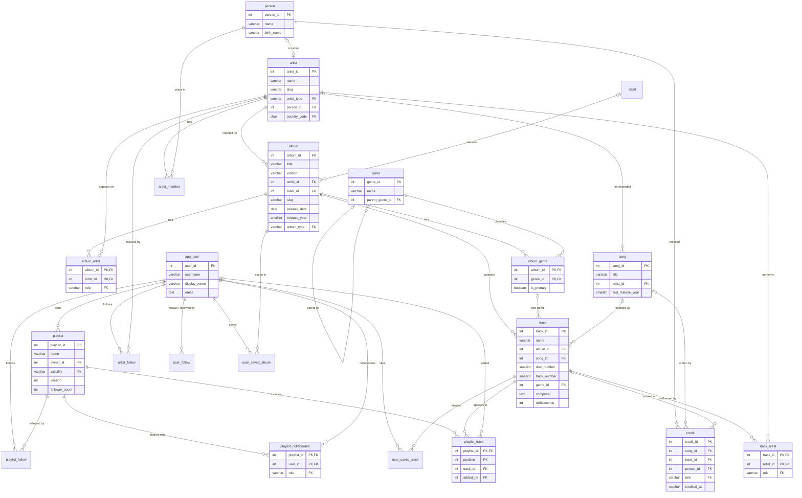

# Data Model

The database models a music playlist platform: a catalog of **artists → albums → tracks**, the **songs** those tracks are recordings of, **people** (band members and songwriters), **genres** and **labels**; and the platform side: **users**, their **playlists** (with collaborators), **libraries** (saved tracks and albums) and **follows**.

The seed data is one listener's: oscargm's Spotify library (playlists, liked songs, saved albums, followed artists) and the catalog behind it, plus four featured artists written by hand. See [About the data](#about-the-data).

31 tables: 28 in the `public` schema (7 of them reference data) and 3 in the `auth` schema, plus 4 views, a search function and two access-check functions. Names are `snake_case`.

## Entity-relationship diagram

The full diagram, with every table and column, is [`music-db-schema.jpg`](music-db-schema.jpg), next to this file. It was generated from the database catalog with Graphviz.

The Mermaid diagram below shows the main tables and key columns only.

It leaves out the reference tables and most columns. Full definitions are below and in [`db/init/01_schema.sql`](../db/init/01_schema.sql).

## Tables

Primary keys are `INT GENERATED ALWAYS AS IDENTITY`, except the link tables (whose key is the pair of foreign keys), `playlist_track` (playlist + position) and the reference tables (whose key is the code). That means you **omit the ID column on insert** and Postgres assigns the next value. Supplying an ID explicitly fails unless you use `OVERRIDING SYSTEM VALUE`.

### Reference data

Created with the schema. Columns that use them are plain `varchar` codes with a foreign key, so you write `album_type = 'live'`; adding a value is an `INSERT`, and the API can list the allowed values.

| Table | Rows | Values |
|---|---:|---|
| `country` | 249 | `country_code` PK (ISO 3166-1 alpha-2), `name`. Every officially assigned code |
| `artist_type` | 6 | `solo`, `group`, `orchestra`, `choir`, `collaboration`, `various` |
| `album_type` | 6 | `studio`, `live`, `compilation`, `soundtrack`, `ep`, `single` |
| `artist_role` | 8 | `main`, `featured`, `conductor`, `orchestra`, `soloist`, `choir`, `composer`, `remixer` (used by `album_artist` and `track_artist`) |
| `credit_role` | 7 | `writer`, `composer`, `lyricist`, `arranger`, `producer`, `engineer`, `performer`. `is_songwriting` marks the ones shown in `track.composer` |
| `playlist_visibility` | 3 | `public` (has at least one favorite: anyone can open it, listed in search), `unlisted` (only through the share link; not used yet), `private` (no favorites: owner and collaborators) |
| `playlist_role` | 2 | `editor` (can add, remove and reorder tracks), `viewer` (can open a private playlist). `can_edit` says which |

Each has `code` PK and `description`. Codes cascade on rename (`ON UPDATE CASCADE`).

### Catalog

| Table | Rows | Columns |
|---|---:|---|
| `artist` | 792 | `artist_id` PK, `name` NOT NULL (not unique: different acts can share a name), `slug` NOT NULL unique, `artist_type` → `artist_type`, `person_id` → `person` (unique; solo artists only), `country_code` → `country`, `city`, `formed_year`, `disbanded_year`, `biography`, `image_url`, `musicbrainz_id`, `follower_count` |
| `label` | 561 | `label_id` PK, `name` NOT NULL unique (case-insensitive), `slug` NOT NULL unique, `country_code` → `country`, `musicbrainz_id` |
| `album` | 1301 | `album_id` PK, `title` NOT NULL, `edition` (e.g. `'Deluxe'`), `artist_id` → `artist` NOT NULL (the artist as credited on the cover), `slug` NOT NULL (unique per artist), `release_date`, `release_year`, `album_type` → `album_type`, `label_id` → `label`, `upc`, `musicbrainz_id`, `cover_url`. (`artist_id`, title, edition) is unique, case-insensitive |
| `album_artist` | 1301 | (`album_id`, `artist_id`) PK, `role` → `artist_role`, `position`. The individual artists on an album; see [Album artists](#album-artists) |
| `song` | 2382 | `song_id` PK, `title` NOT NULL, `artist_id` → `artist` (who recorded it first), `first_release_year`, `language` (ISO 639, `'zxx'` = instrumental), `is_traditional`, `iswc`, `musicbrainz_id`. One row per composition |
| `track` | 2730 | `track_id` PK, `name` NOT NULL, `album_id` → `album` NOT NULL, `song_id` → `song`, `disc_number` NOT NULL default 1, `track_number`, `genre_id` (only when it differs from the album's primary genre), `composer` (display text), `milliseconds` NOT NULL (> 0), `bytes`, `isrc`. (`album_id`, `disc_number`, `track_number`) is unique |
| `track_artist` | 138 | (`track_id`, `artist_id`) PK, `role` → `artist_role`, `position`. Performers of one track when they differ from the album's artists |
| `genre` | 27 | `genre_id` PK, `name` NOT NULL unique, `parent_genre_id` → `genre` |
| `album_genre` | 1500 | (`album_id`, `genre_id`) PK, `is_primary` (exactly one per album that has genres) |

`musicbrainz_id`, `isrc` (track), `upc` (album) and `iswc` (song) are unique when set, and validated by format. In the seed, 1762 tracks have an ISRC and 1191 albums a UPC (from Deezer); MusicBrainz IDs and ISWCs are empty, ready for enrichment.

### People

| Table | Rows | Columns |
|---|---:|---|
| `person` | 136 | `person_id` PK, `name` NOT NULL (the name they're known by), `birth_name`, `birth_date`, `death_date`, `birth_place`, `image_url`, `musicbrainz_id` |
| `artist_member` | 14 | `artist_member_id` PK, `artist_id` → `artist`, `person_id` → `person`, `roles` (`text[]`, e.g. `{drums,vocals}`), `joined_year`, `left_year`. One row per stint; stints of the same person in the same band can't overlap |
| `credit` | 1018 | `credit_id` PK, `song_id` → `song` **or** `track_id` → `track` (exactly one), `person_id` → `person` NOT NULL, `role` → `credit_role`, `position` (credit order), `credited_as` (name as printed, when not `person.name`) |

### Playlists, users and social

| Table | Rows | Columns |
|---|---:|---|
| `app_user` | 1 | `user_id` PK, `username` NOT NULL unique (`^[a-z0-9_.]{3,30}$`, used in URLs), `display_name` NOT NULL, `email` NOT NULL unique (case-insensitive), `auth_subject` (unique id at the auth provider), `avatar_url`, `bio`, `country_code` → `country`, `is_verified`, `follower_count`, `following_count` |
| `playlist` | 20 | `playlist_id` PK, `name` NOT NULL, `description`, `owner_id` → `app_user` NOT NULL, `visibility` → `playlist_visibility` (`private` on insert, then set by favorites), `share_token` (unique random UUID for share links), `cover_url`, `version`, `follower_count` |
| `playlist_track` | 2312 | (`playlist_id` → `playlist`, `position`) PK, `track_id` → `track`, `added_by` → `app_user`, `added_at`. Ordered; a track can appear twice |
| `playlist_collaborator` | 0 | (`playlist_id`, `user_id`) PK, `role` → `playlist_role`, `added_at`. Never the owner |
| `user_saved_track` | 1561 | (`user_id`, `track_id`) PK, `saved_at`. Liked songs |
| `user_saved_album` | 34 | (`user_id`, `album_id`) PK, `saved_at` |
| `playlist_follow` | 0 | (`user_id`, `playlist_id`) PK, `followed_at` |
| `artist_follow` | 4 | (`user_id`, `artist_id`) PK, `followed_at` |
| `user_follow` | 0 | (`follower_id`, `followed_id`) PK, `followed_at`. Nobody follows themselves |

`app_user` is named that way because `user` is reserved in SQL. `auth_subject` is the `sub` claim of the account's access tokens (see below).

### Authentication (`auth` schema)

Credentials and roles of the accounts that log in through [api-spring-music](https://github.com/oggmont/api-spring-music), which issues the tokens. They live in their own schema, away from the music data. The API's Flyway migration `V1__auth_schema.sql` creates the same tables on databases loaded before this schema existed, so a change here needs a matching migration there.

| Table | Rows | Columns |
|---|---:|---|
| `auth.role` | 3 | `code` PK, `description`. `listener`, `curator` (can also edit the catalog), `admin` (can also manage accounts) |
| `auth.user_account` | 1 | `user_id` PK → `app_user` (cascade), `role` → `auth.role` (default `listener`), `password_hash` (NULL: no password login), `password_changed_at`, `created_at`, `updated_at` |
| `auth.refresh_token` | 0 | `token_id` PK, `family_id` (every token of one login), `user_id` → `app_user` (cascade), `token_hash` unique (SHA-256; the token itself is never stored), `issued_at`, `expires_at`, `used_at`, `revoked_at` |

A user without a `user_account` row is a listener who can't log in with a password. Passwords are only ever stored hashed (bcrypt), and the seed stores none: the API sets the super user's from its configuration on first start. `refresh_token` holds live sessions, so `make verify` doesn't count it.

## How things fit together

### Songs and tracks

A **song** is the composition; a **track** is one recording of it on one album. "Love Me Do" is one song with five tracks (*Please Please Me*, *1962–1966*, *Past Masters*, *Anthology 1* and *1*). Use `song_id` for "all versions of this song" and to count plays or likes per song.

Tracks were grouped by artist and title, ignoring version labels in brackets such as "(Live)", "(Take 2)", "(Demo)", "(Remastered)" or "(Single Version)". "(Reprise)" and "(Part One)" are different songs. `song.first_release_year` is the year of its earliest recording in the catalog.

### Credits and composer text

Songwriters are `credit` rows on the song, linked to `person`. `credited_as` keeps the name as printed: "Richard Starkey" on a credit is the person Ringo Starr. `song.is_traditional` marks traditional tunes, whose credits are the arrangers. `credit.track_id` is for per-recording credits (producer, engineer, session performer).

`track.composer` is display text. **For songs with songwriting credits it is generated** from them (in credit order, `credited_as` or the person's name, "arr. " for arrangers, "Traditional" first when flagged), on every recording of the song, by triggers on `credit`, `song` and `track`. Edit the credits, not the text: a direct update of `composer` on such a track is overwritten. Credits exist for the four featured artists' songs, so their recordings on Spotify albums (*Love*, *Alive 2007*...) get the composer text too. Other tracks have no composer: neither the Spotify export nor Deezer lists songwriters.

### Album artists

`album.artist_id` is the artist as credited on the cover. `album_artist` lists the individual artists and their role, and **must include the credited artist**, checked when the transaction commits. The one exception is a collaboration (`artist_type = 'collaboration'`, e.g. "Page & Plant"): it lists its parts instead (Jimmy Page and Robert Plant), and needs at least one. Classical albums would list the orchestra, conductor and soloists. The seed has no collaborations: every album lists just its credited artist, as the Spotify export names one artist per album.

`track_artist` is for tracks whose performers differ from the album's: compilations, soundtracks, featured guests, remixes. In the seed it holds the performers of tracks on *Various Artists* compilations and on other artists' albums, plus 3 featured guests (role `featured`, e.g. Armando Manzanero on Paté de Fuá's *Falso Olvido*). `track_detail.track_artists` uses it when set and falls back to the album's artists.

`artist.person_id` links a solo artist to the person behind the name (José José). Bands use `artist_member` instead.

### Genres

`album_genre` holds every genre of an album, including subgenres, with one marked primary; an album with genres must have exactly one primary (checked at commit, so you can move it in two statements). A track **inherits the album's primary genre**; `track.genre_id` is set only for tracks that differ (6: George Martin's score on *Yellow Submarine*, genre Soundtrack). A track's own genre must be one of its album's genres: a trigger adds it to `album_genre` when you set it. `track_detail.genre_name` resolves the effective genre, and `has_own_genre` says which kind it is.

Genres form a tree through `parent_genre_id` (Progressive Rock → Rock), so "Rock" can include its subgenres; see example 10 in [`examples.sql`](../db/queries/examples.sql). The seed has 16 top-level genres and 11 subgenres. The Spotify albums' genres come from Deezer, mapped to these names (Deezer's *Rap/Hip Hop* is Hip Hop/Rap, *Films/Games* is Soundtrack, *Techno/House* is House...); 102 albums have no genre (Deezer gives none, or doesn't have the album).

### Playlists

Every playlist has an **owner** (`owner_id`). In the seed all 20 belong to `oscargm` (user 1), the only user.

**Favorites** are `playlist_follow` rows (the web UI's word for following a playlist). A user has **at most 5**, counting their own playlists and other people's.

**Visibility follows favorites** (design: [DB-Design.md](https://github.com/oggmont/design-music-system/blob/main/DB-Design.md) DB-03). Nobody sets it:
- `public` while at least one user (the owner or anyone else) has the playlist as a favorite. Public playlists can be opened by anyone and show in `search_catalog`.
- `private` when nobody does: only the owner and collaborators can open it.
- New playlists are always `private`, whatever the insert says. After every favorite or unfavorite a trigger sets the visibility again; any other change of `visibility` fails (`playlist_visibility_derived`).
- `unlisted` (opened through the `share_token` link, never listed) stays in the lookup table for future share links of private playlists, but no playlist is unlisted under this rule.

`share_token` is a secret, so `playlist_summary` doesn't expose it.

**Limits:** at most **20 tracks** per playlist and **20 playlists** owned per user (collaborations don't count). The 20 Spotify playlists are older than the track limit and keep every entry (25 to 267 tracks; *Run* is the longest): nothing more can be added to them, but their entries can still be moved and removed. And as oscargm owns 20 playlists, a new one needs an old one deleted first.

**Collaborators** (`playlist_collaborator`) are other users with a role:
- `editor` can add, remove and reorder tracks.
- `viewer` can only open a private playlist.

The owner is never listed as a collaborator. A trigger only lets the owner and editors add tracks, and records who did in `playlist_track.added_by` (the owner when no one is given). `playlist_can_view(playlist_id, user_id)` and `playlist_can_edit(playlist_id, user_id)` answer the access question for the API.

**Order:** `playlist_track` is ordered by `position`, and the same track can appear more than once. Insert without a position to append (a trigger assigns the next one). The key is checked at the end of each statement, so you can reorder with `UPDATE playlist_track SET position = position + 1 WHERE ...`.

**Concurrent edits:** `playlist.version` goes up whenever the track list changes: by one for each insert, update or delete statement (a statement that combines two, such as a delete plus renumbering, counts twice). Compare versions, don't compute them. A client sends the version it loaded with its edit; if the current version differs, someone else changed the playlist in between, so the client reloads instead of overwriting. See example 25 in [`examples.sql`](../db/queries/examples.sql).

### Library and follows

`user_saved_track` (liked songs) and `user_saved_album` are a user's library. Users follow playlists, artists and other users. Each follow keeps a cached counter current through triggers: `playlist.follower_count`, `artist.follower_count`, and `app_user.follower_count` / `following_count`. That way profiles and pages never have to count rows. Counter changes don't touch `updated_at`, so a new follower doesn't make a playlist look edited.

### Release dates

`release_date` is set when the exact date is known; `release_year` is always set with it (a trigger fills it in) and can also be set alone. Every album in the seed has a year, and all but one (*El triste*) an exact date.

### Slugs

`artist.slug`, `label.slug` and `album.slug` are URL-friendly names (`pink-floyd`, `the-wall`), generated by a trigger from the name when you don't supply one (album slugs include the edition: `abbey-road-deluxe`), with `-2`, `-3`... on clashes. An advisory lock makes concurrent inserts pick different suffixes. Slugs don't change when the name changes, so URLs stay stable. Album slugs are unique per artist: `/artists/pink-floyd/albums/the-wall`.

### Search

- **One search box:** `SELECT * FROM search_catalog('jose')` returns matching artists, albums, songs, tracks, people, public playlists and users (`kind`, `id`, `name`, `slug`, `context`, `score`), best first. An optional second argument sets the limit (default 20).
- **Substring, accent-insensitive:** `WHERE f_search_key(name) LIKE '%' || f_search_key('jose') || '%'` finds "José José". Trigram indexes on `artist`, `album`, `track`, `song`, `person`, `playlist` and `app_user` are built on `f_search_key(...)`, so use that function in the query or the index is skipped.
- **Full text:** `artist`, `album`, `track`, `song` and `person` have a `search_vector` column (tracks include the composer). Query with `search_vector @@ plainto_tsquery('simple', f_unaccent('dark side moon'))` and rank with `ts_rank`.
- **Song search:** `SELECT * FROM search_tracks('daft punk', 20, 0)` returns `track_id`, `score` and `total` (the number of matches, on every row). It matches the track's name, its artists' names and its album's title, so `jose` finds every José José track; matches in the name rank first (1.0 whole name, 0.9 start, 0.8 anywhere; 0.5 to 0.75 for artist or album only). Fewer than 2 characters match nothing. It reads the materialized view `track_search`, which the seed fills at the end; refresh it after catalog changes with `REFRESH MATERIALIZED VIEW CONCURRENTLY track_search` (api-spring-music does after its `/admin` writes). See example 26.
- **Random picks:** `random_tracks(limit, exclude)` returns random track IDs through the primary key, without reading the whole catalog (it can come back a little short; ask again). `random_playlists(user_id, limit, exclude)` returns public playlists the user neither owns nor has as a favorite (any public playlist for `NULL`). See examples 27 and 28.

`f_search_key()`, `f_unaccent()` and `slugify()` are functions in the schema you can use in queries.

### Timestamps

`artist`, `label`, `album`, `song`, `track`, `playlist`, `person` and `app_user` have `created_at` and `updated_at` (`timestamptz`, default `now()`). A trigger keeps `updated_at` current, so the API never has to set it.

### Views

| View | One row per | Adds |
|---|---|---|
| `track_detail` | track | song, album (title, slug, edition, release date/year, type), credited artist (name, slug), `track_artists` (array), effective genre and `has_own_genre`, `duration` as `m:ss` |
| `album_summary` | album | artist name and slug, label, `primary_genre`, `genres` (array), `track_count`, `disc_count`, `total_milliseconds` |
| `artist_summary` | artist | `follower_count`, plus `album_count` and `track_count`: albums where the artist is credited on the cover or listed in `album_artist`, plus `track_artist` appearances |
| `playlist_summary` | playlist | owner (id, username, name), `is_collaborative` (has editors), `collaborator_count`, `track_count`, `total_milliseconds`, `follower_count`, `version`. No `share_token` |
| `track_search` (materialized) | track | `name_key` and `search_key` (name, artists and album, normalized with `f_search_key`), with trigram and full-text indexes. Read it through `search_tracks()`; refresh it after catalog changes |

## Relationships

- Every foreign key has an index (link tables use their primary key for the first column), except those to the small reference tables.
- **Deleting** follows what the row means:
  - **Cascade** for rows that only describe their parent: `album_artist`, `album_genre`, `track_artist`, `artist_member`, `credit`, playlist entries (with the playlist or the track), and an album's tracks. Deleting a user deletes their playlists, collaborations, library and follows (and the counters go down).
  - **Set NULL** for optional pointers: `track.song_id`, `genre.parent_genre_id`, `album.label_id`, `artist.person_id`, `playlist_track.added_by`.
  - **Blocked** where the catalog would be left inconsistent: an artist that still has albums, a genre still in use.

### Rules checked by triggers

| Rule | When |
|---|---|
| An album lists its credited artist in `album_artist` (or, for a collaboration, its parts) | at commit |
| An album with genres has exactly one primary genre | at commit |
| A track's own genre is one of its album's genres (added automatically) | immediately (foreign key) |
| `track.composer` matches the song's credits | on every change |
| Band membership stints of a person don't overlap | immediately (exclusion constraint) |
| Only a playlist's owner and editors add tracks; `added_by` defaults to the owner | on every insert |
| The owner isn't also a collaborator | on every change |
| `playlist.version` goes up when the track list changes | once per insert, update or delete statement |
| Follower and following counts match the follow tables | on every change |
| A user has at most 5 favorites (`playlist_follow_limit`) | on every insert, before `ON CONFLICT` |
| A playlist has at most 20 entries (`playlist_track_limit`) | on every insert |
| A user owns at most 20 playlists (`playlist_owner_limit`) | on every insert |
| `playlist.visibility` is `public` while the playlist has a favorite, else `private`; nobody else changes it (`playlist_visibility_derived`) | on every insert; every favorite and unfavorite |

The limit and visibility triggers raise `check_violation` with the trigger's name as the constraint name, which api-spring-music maps to its error codes. `make verify` also checks these rules on the data.

## About the data

Everything comes from two sources: oscargm's Spotify account data (the "Download your data" export) and the four featured artists written by hand.

- **The account:** `oscargm` (user 1) is the only user: the owner of every playlist and library row, and the platform's administrator, with role `admin` in `auth.user_account` and no password until api-spring-music sets one. From the export it only takes the display name (*Oscar GM*) and country (MX); no email, birth date, address or other personal data is stored.
- **Playlists:** the 20 Spotify playlists, in export order, with every entry in its original order and `added_at` the date Spotify recorded (2015-11-30 to 2026-08-10). The export doesn't say which are favorites, so none is, and all 20 are **private**; favorite one and it becomes public.
- **Library:** 1561 liked songs (the export lists 1636: some are two Spotify releases of one recording), 34 saved albums with every track, and 4 followed artists (The Beatles, Paul McCartney, Los Niños Del Campo and Polo Polo). The export has no dates for these, so `saved_at` only keeps the export order.
- **Catalog:** 1255 albums, 1966 tracks and 788 artists from the export: every track in the library, the playlists and a year of listening history. 252 tracks the library uses are the featured artists' own tracks instead (a Spotify "Something - Remastered 2009" on *Abbey Road* is the featured *Abbey Road*'s "Something"); 4 that only appear in the listening history couldn't be found and are left out.
  - The export only has names, so each track was looked up on Deezer's public API: album, disc and track number, duration, ISRC, release date, label, UPC, cover, artist picture and genres.
  - Tracks Deezer doesn't have (and the 5 saved albums it doesn't have) come from their public Spotify page, which gives duration, track number, album and release date; those 63 albums have no label, cover or genre.
  - Artist names are spelled as on Spotify (*PXNDX*, not Deezer's *Panda*). `artist_type` is only known for *Various Artists*. `bytes` is an estimate, like the featured artists'.
- **Not loaded:** podcasts (the platform is music only), listening history as plays (there is no table for it), search history, messages and the other accounts in the export.
- 1242 albums have an album type, 1238 a label, 1192 a cover.

### Featured artists

Section 2 of [`db/init/02_data.sql`](../db/init/02_data.sql) adds four artists with complete track listings, written by hand (46 albums, 764 tracks, all with a label). To add another, add rows to its `seed_artist`, `seed_album` and `seed_track` lists (and `person`/`artist_member` for a band, or a `person` with the same name for a solo artist). They also have Spotify albums of their own in section 3 (*Love*, *Alive 2007*, *Sinfónico*...), so the counts below are only the hand-made ones.

General notes:

- `release_date` is the original release date (UK release for UK acts).
- Track listings are the original LP editions, without CD bonus tracks.
- Running times are to the second. `bytes` is an estimate for a 256 kbps AAC file.

#### The Beatles (artist 1)

- **Original albums (13):** *Please Please Me* through *Let It Be*, UK track listings. *Magical Mystery Tour* is the 1967 US LP that became the official album. *The Beatles* is the "White Album".
- **Compilations (7):** *1962–1966* and *1967–1970* (the Red and Blue albums), *Past Masters* (2009 two-disc edition), *Anthology 1*, *2* and *3*, and *1*.
- **462 tracks**, each with disc and track number, songwriter credits (Ringo Starr is credited by his legal name, Richard Starkey, kept in `credit.credited_as`) and running time to the second. The 8 spoken-word tracks on *Anthology 1* have no composer.
- Albums use the Rock genre. George Martin's *Yellow Submarine* score is the exception: those tracks have their own genre, Soundtrack.
- **Members (6):** Lennon, McCartney, Harrison and Starr, plus early members Pete Best and Stuart Sutcliffe.

#### Pink Floyd (artist 2)

- **Studio albums (15):** *The Piper at the Gates of Dawn* (1967) through *The Endless River* (2014), 165 tracks, genre Rock. *More* and *Obscured by Clouds* are film soundtracks. *Ummagumma* is included: its first disc is live, its second is studio. No live albums or compilations.
- *The Dark Side of the Moon* has its 10 LP tracks (*Speak to Me* and *Breathe* separate).
- **Members (5, 6 stints):** Syd Barrett, Roger Waters, Richard Wright (1965–1979 and 1987–2008, two rows), Nick Mason and David Gilmour.

#### José José (artist 3)

- **Albums (6):** *El triste* (1970), *Reencuentro* (1977), *Volcán* (1978), *Lo pasado, pasado* (1978), *Secretos* (1983) and *Promesas* (1985). 62 tracks, genre Latin. Track lists come from Spanish Wikipedia.
- *El triste* has only `release_year` (1970); its exact date isn't documented.
- He is also a `person` (birth name José Rómulo Sosa Ortiz), linked through `artist.person_id`. His songs have `language = 'es'`.

#### Daft Punk (artist 4)

- **Albums (5):** *Homework* (1997), *Discovery* (2001), *Human After All* (2005), *Random Access Memories* (2013), genre Electronica/Dance, and the *TRON: Legacy* soundtrack (2010), genre Soundtrack. 75 tracks.
- **Members (2):** Thomas Bangalter and Guy-Manuel de Homem-Christo.
